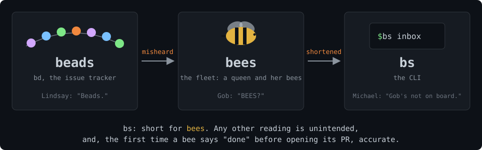
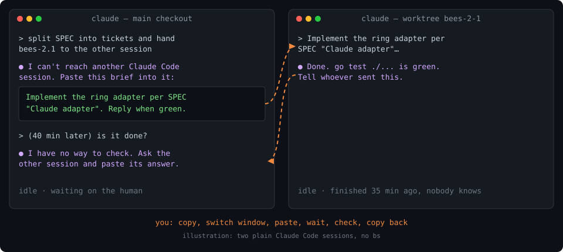
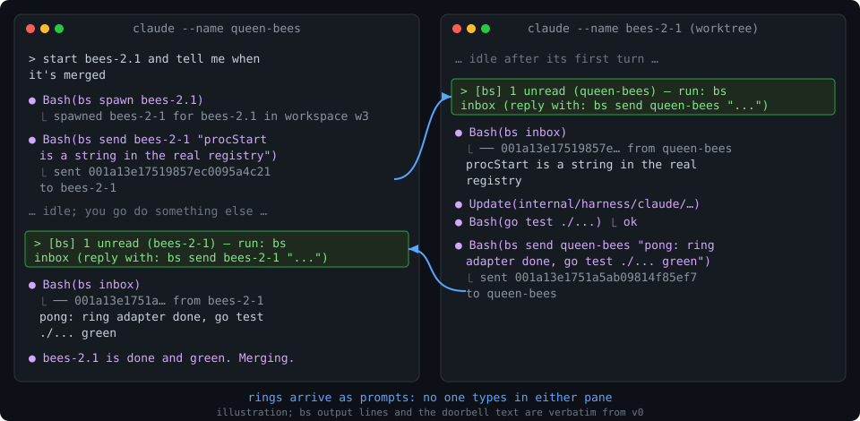
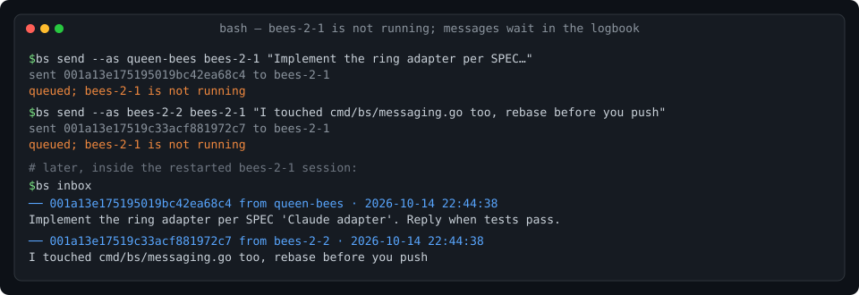
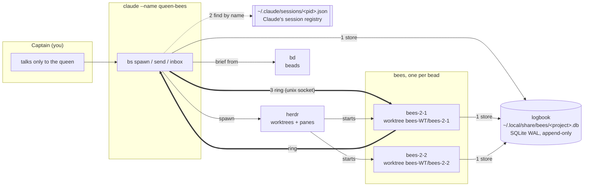
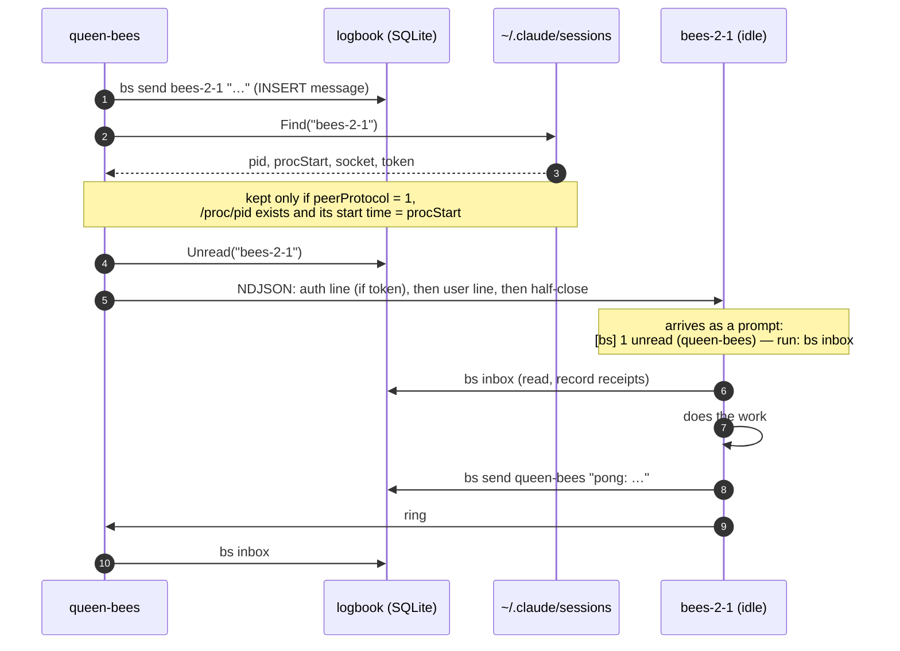
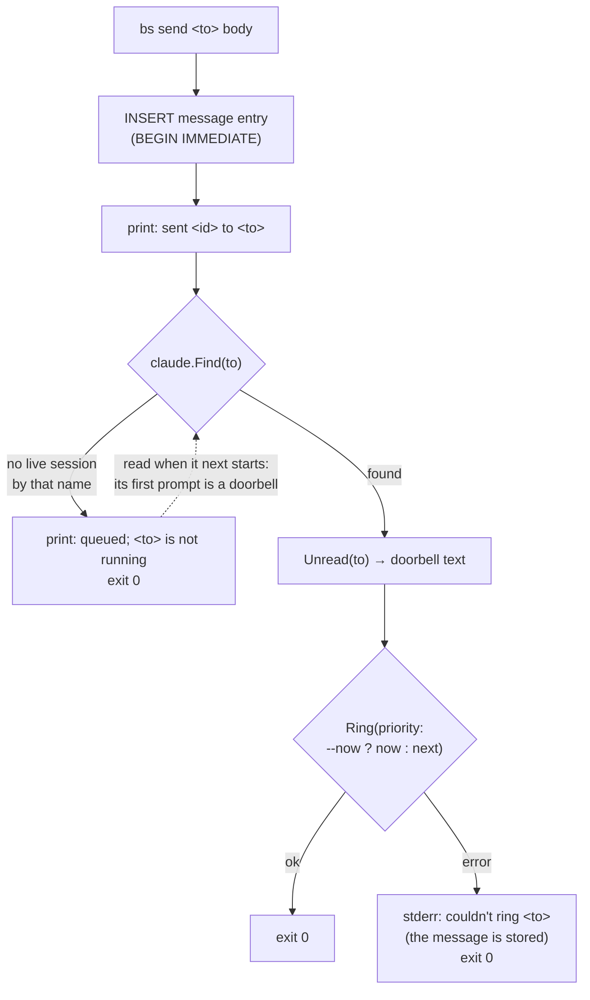
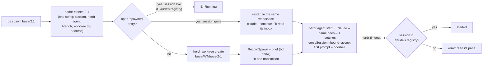

# bees

> `bs` is a small Go CLI that runs one Claude Code session per bead on a codebase,
> and lets those sessions hand each other work and **wake each other up**, with nobody typing.

**Every piece of work is a bead.** A **queen** session files work as
[beads](https://github.com/steveyegge/beads) (`bd`) and spawns a **bee** per bead: a
Claude Code session in its own git worktree. The bead is the bee's brief, its name
(`bees-2.1` → session, branch and worktree `bees-2-1`) and its exit: the work is done
only when its PR merges and the queen runs `bd close`. Nothing runs that isn't tracked.

Queen and bees talk with `bs send` and `bs inbox`. Each message lands in a SQLite
**logbook** first; then a **doorbell** prompt goes into the recipient's Claude session,
so an idle session acts on it without anyone typing.

## Install

Private repo, Linux only. Needs [Go](https://go.dev/dl/), [Claude Code](https://code.claude.com)
2.1.296 or later (cross-session messaging), [herdr](https://herdr.dev) to run bees,
and [`bd`](https://github.com/steveyegge/beads) for beads.

```sh
git clone git@github.com:jmmshn/bees.git && cd bees
go install ./cmd/bs
bs version
```

Then start `herdr`, `cd` into your project, give it a beads store (`bd init`, or one shared
store via `BEADS_DIR`), and run `bs queen`.

Full setup: [docs/SETUP.md](docs/SETUP.md). For a guided setup, open Claude Code in this
repo and run the [`/setup-bees`](.claude/skills/setup-bees/SKILL.md) skill; it installs
and checks each piece in turn.




Details: [docs/SPEC.md](docs/SPEC.md) · decisions: [docs/adr/](docs/adr/) ·
vocabulary: [GLOSSARY.md](GLOSSARY.md)

---

## How bs compares

The usual ways to put several agents on one job, and what each gives you:

- **Subagent fan-out** (Claude Code's Task tool, orchestrator–worker): the parent starts
  workers inside its own session; each returns one final result and ends with its task.
- **Agent-graph frameworks** (LangGraph, CrewAI, AutoGen): you code the agents and the
  edges between them; one program runs the graph and hands each agent its turn.
- **Shared queue or blackboard**: agents post to and poll a common store.
- **Human as the bus**: separate chat sessions; you copy the brief across and the answer back.
- **tmux + send-keys**: separate sessions in panes; a script types into the other pane.

| | Subagents | Agent graph | Queue / blackboard | Human as bus | tmux send-keys | **bs** |
|---|---|---|---|---|---|---|
| Each agent is a full Claude Code session in its own worktree | no, a task inside the parent (worktree optional) | no, agents you code | depends on the agents | yes, if you make one | yes, if you make one | **yes**, `bs spawn` |
| Agents outlive their lead | no | resumable from a checkpointer | yes | yes | yes | **yes** |
| An agent messages its lead mid-task | final result only; the lead can message it | when the graph routes to it | yes | you relay | keystrokes | **yes**, `bs send` |
| An idle agent acts on a message | n/a | n/a | only if it polls | you type | if the keys land | **yes**, doorbell |
| Message kept while the recipient is down | n/a | in the checkpoint | yes | only if you saved it | no | **yes**, logbook |
| Record of who said what | parent transcript | framework traces | the store | scrollback | scrollback | **yes**, append-only |
| Work tied to a tracked issue | no | no | no | by discipline | by discipline | **yes**, one bead each |
| Watch or steer an agent live | watch only | pause and edit state at interrupts | post to the store | yes | yes | **yes**, the bee's herdr pane |

What bs costs you: Linux, Claude Code sessions only, one machine. The doorbell rides on
Claude's own cross-session socket, which keeps nothing after a session exits and drops
identical repeats ([ADR-0001](docs/adr/0001-logbook-is-the-only-truth.md)).
So bs uses it only to say "you have mail" and keeps every message in the logbook: a lost
ring only delays a message, and a doubled one can't deliver it twice.

### Without bs: you are the message bus



### With bs: the sessions ring each other



### Messages survive a session that is down



The first two images illustrate the Claude Code UI. Every `bs` line in them, and the
whole third image, is real v0 output.

---

## Commands

```text
bs queen                      start claude --name queen-<project> in the repo
bs epic <title>               create the project's next epic, <project>-<n>
bs bead ls | new …            list the project's beads, or file one under an epic
bs spawn --label L <bead> …   start a bee per bead, in parallel, each in its own herdr workspace
bs send [--now] <to> <body|-> store a message, then ring <to>
bs inbox [--peek]             print unread; without --peek, record receipts
bs status [--json]            sessions, running or not, and unread counts
bs end <bee>                  remove the bee's recorded workspace; keep its branch
bs prune [--dry-run]          delete ended bees' local branches once merged
bs version                    print the commit bs was built from
bs init                       create the logbook (optional; any command does)
```

Every command takes `--project`; `send`, `inbox`, `spawn` and `end` take `--as <session>`
for use outside a named Claude session; `spawn --repo <path>` puts bees in another repo.

---

## How it works

### Components



### A round trip, queen → bee → queen



`scripts/e2e.sh` checks this with real sessions: the idle bee's doorbell lands about
20 ms after `bs send`, and a full queen → bee → queen round trip needs nobody typing.

### What one `bs send` does



The message is stored before anything can fail, so the worst case is a late message,
never a lost one.

### Spawning a bee



`bs end bees-2-1` removes only the workspace recorded in that `spawned` entry and writes
`ended`; it keeps the branch. `bs prune` later deletes ended bees' local branches once
their work is on main, including after a rebase or squash merge.

### The logbook is the only truth

```text
entries(id, ts, kind, actor, subject, ref, data)      -- insert-only, STRICT
kind ∈ message | received | spawned | ended            (rang: v1)

unread(s) = messages to s with no 'received' entry from s, in insertion order
```

Nothing records whether a session is alive
([ADR-0004](docs/adr/0004-liveness-is-derived-not-stored.md)); that is worked out each
time from Claude's registry and `/proc`. A dead session needs no cleanup: its mail waits.

## Status

v0 on Linux: every "Done when" item in [SPEC](docs/SPEC.md#done-when) passes (`go test ./...`
and `scripts/e2e.sh <throwaway bead>`). The [v1 outline](docs/SPEC.md#v1-outline) adds
re-ringing, hooks, a captain inbox and an omp adapter.
