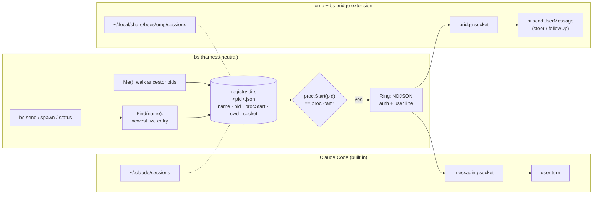

# omp harness adapter (design, bees-21.1)

bs drives Claude Code through `internal/harness/claude`, `internal/proc`, `project.Me` and the worker launch. This note maps that contract onto oh-my-pi (omp 18.8.6) and proposes one interface both satisfy. Design only: no code.

**Evidence key.** ✓ = verified here (command run, file read); ~ = inferred from omp source, not run live. omp couldn't run a turn on this machine (`omp -p` and `omp --mode rpc` both stop at "No default model selected"), so nothing omp-side ran past argument parsing. omp source = the npm package `@oh-my-pi/pi-coding-agent@18.8.6`, matching `omp --version` ✓.

## The contract bs needs

| # | Contract item | Claude Code (today) | omp |
|---|---|---|---|
| 1 | **Start a named session** with role prompt and first prompt | `herdr agent start --kind claude -- --name N --settings F --append-system-prompt-file P "<doorbell>"`; queen: `exec claude --name …` | `herdr agent start --kind omp` ✓ (`herdr agent start --help` lists `omp`). `--append-system-prompt <text or file>`, `-e <extension>`, positional first message ✓ (`omp --help`). **No `--name`** ✓. The name arrives as an extension flag (`pi.registerFlag`, `extensions/types.ts:1539`) and is applied with `pi.setSessionName` (`:1645`) ~ |
| 2 | **Resume** the last conversation in the worktree | `--continue` | `-c/--continue` ✓ (help). Behaviour with no prior session is unknown ~ |
| 3 | **Per-session policy**: env (`BS_PROJECT`), deny rules, auto-mode allow/environment | One `--settings` file: `env`, `permissions.deny` globs, `autoMode`, `crossSessionInbound` | Tool approval is per tool (`allow\|deny\|prompt`) plus `tools.approvalMode` `always-ask\|write\|yolo`, and the schema default is `yolo` ✓ (`tools/approval.ts`). **No command-pattern deny, no auto-mode classifier.** An extension's `tool_call` handler can return `{block, reason}` ✓ (`examples/hooks/permission-gate.ts`) |
| 4 | **Registry**: list live sessions by name, liveness checked by pid+start | `~/.claude/sessions/<pid>.json`: `name, pid, procStart, cwd, messagingSocketPath, peerProtocol` | **None across processes** ✓. `AgentRegistry`/`IrcBus` are in-process (`irc/bus.ts`: "process-global"). The collab registry is host-only and offers just `snapshot`/`link` (`collab/registry.ts`). Daemon presence files hold `{pid,id,projectDir}` only (`launch/presence.ts`; one seen in `~/.omp/run/daemons/*/clients`) |
| 5 | **Ring**: deliver text into a live session as a user prompt, `now`/`next` | Unix socket, NDJSON `auth` line then a `user` line, then half-close | **No socket** ✓. `--mode rpc` takes `prompt`/`steer`/`follow_up`, but only over the stdio of the process that started omp, which then has no TUI (`modes/rpc/rpc-types.ts`). An extension can call `pi.sendUserMessage(text, {deliverAs: "steer"\|"followUp"})` (`types.ts:1597`), and omp's own `examples/hooks/file-trigger.ts` uses an extension "for external systems to send messages to the agent" ✓ |
| 6 | **Identity** (anti-spoof): which session ran this `bs` | `project.registered`: walk ancestor pids to a registry entry whose `procStart` matches; also returns the launch `cwd` | Same walk works if (4) exists and bash-tool children descend from the omp pid. The bash tool runs on an in-process native `Shell` (`exec/bash-executor.ts`) ~. omp exports no session id to children except `PI_SESSION_FILE` in eval ✓, and env is spoofable anyway |
| 7 | **Startup prompts** that block launch | Folder trust (`claude.Trusted` reads `~/.claude.json`) | No trust dialog in help or settings ~ → `Trusted` is always true |

## The shared core

Rows 4–6 are the same mechanism in both harnesses: **a registry file per live process, keyed by pid and start time, that names the session and points at a socket that turns a line into a user turn.** Claude ships it. omp gets it from a small bs-owned extension, the *bridge*. If the bridge writes Claude's entry shape and speaks Claude's wire protocol (`peerProtocol: 1`), then `List`, `Find`, `Ring` and `registered` stay one piece of code that reads one more directory.



**The bridge** (`bs-bridge.ts`, shipped by bs like the role prompts and written to its cache at launch):

- `session_start`: take `--bs-name`, `setSessionName`, listen on a private unix socket, write `<pid>.json` (0600) plus a token key file, with `procStart` computed exactly as `proc.Start` does (`/bin/ps -o lstart=` under `LC_ALL=C TZ=UTC` on macOS, `/proc/<pid>/stat` field 22 on Linux). Set `process.env.BS_PROJECT` from `--bs-project`.
- On a ring: check the token, then `sendUserMessage(content, {deliverAs: now ? "steer" : "followUp"})`. An idle session starts a turn.
- `tool_call`: block bash commands that match the policy's deny globs, using Claude's `*` semantics.
- `session_shutdown`: remove the entry and the socket. A crash leaves a stale entry, which the procStart check already ignores.

## Gaps and options

1. **No session name or registry.** (a) *Recommended:* the bridge writes a Claude-shaped entry. (b) The collab registry: needs a collab host running, carries no bs name, and can't inject a prompt. (c) herdr agent names: ADR-0007 already found these unreliable.
2. **No inbound channel.** (a) *Recommended:* bridge socket plus `sendUserMessage`. (b) `herdr agent prompt` keystrokes: a fragile wake (motif 10). (c) `--mode rpc` with bs as the parent: no TUI, so the keeper can't watch or answer the worker in its pane.
3. **No auto-mode classifier or pattern deny.** (a) *Recommended:* the bridge enforces `Policy.Deny`. The allow and environment sentences have no consumer, so they move into the role prompt as plain guidance. Run with `--approval-mode write`, or `yolo` plus the deny hook. Branch protection stays the real guard, as it is for Claude. (b) `always-ask`: the keeper approves every write, which defeats unattended workers.
4. **Bridge version skew.** omp's extension API moves fast (v18). Record `peerProtocol` and the omp version in the entry. bs skips entries it doesn't understand and reports them in `bs status`, rather than counting them as not running (motif 11).
5. **Unverified live.** Before building, run one probe on a machine with omp model auth: a `-e` extension gets `--bs-name`, `setSessionName` persists, `sendUserMessage` from a socket callback wakes an idle TUI session, and `ps` from the bash tool reaches the omp pid.

## Proposed interface

```go
package harness

type Priority string // "now" | "next"

// Session is a live entry in a harness's registry (Claude-shaped for both).
type Session struct {
	Name, Cwd, Socket, Token, ProcStart string
	PID                                 int
	StartedAt                           int64
}

// Policy is what a worker may do, in harness-neutral form.
type Policy struct {
	Env         map[string]string // BS_PROJECT
	Deny        []string          // Claude-style Bash globs
	Allow, Note []string          // classifier sentences; prompt text where no classifier exists
}

type Launch struct {
	Name, PromptFile, FirstPrompt string
	Continue                      bool
	Policy                        Policy
}

type Harness interface {
	Kind() string // herdr --kind and the executable: "claude", "omp"
	// Prepare writes per-start files (settings, bridge) and returns the agent args.
	Prepare(l Launch) (args []string, cleanup func(), err error)
	Sessions() ([]Session, error) // live and verified by pid+procStart; unreadable → error
	Ring(s Session, text string, p Priority) error
	Trusted(dir string) bool
}

// Harness-neutral, over every registered Harness:
func Find(name string) (Harness, Session, error) // newest across harnesses; ErrNotRunning
func Registered() (name, cwd string, ok bool, err error) // the ancestor walk from project.Me
```

`Ring` can live once in `harness`, since the wire is shared. `Sessions` differs only in the directory it reads. Which harness a spawn uses (`bs spawn --harness omp`, or a per-project default) is open: a project can mix a Claude queen with omp workers, because messages go through the logbook and `Find` searches every harness.
